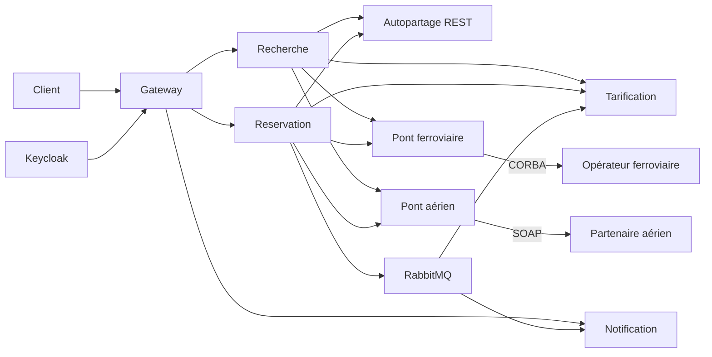
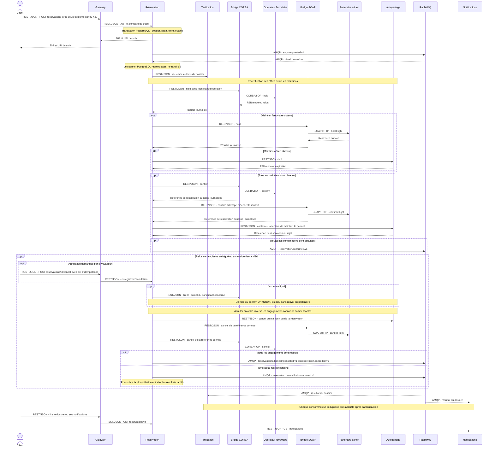

# Mobilité multimodale

## Démarrage rapide

Prérequis pour la démonstration locale. Docker avec Compose v2, Bash, Python 3 et les ports locaux 1050, 8080, 8081, 8088, 9464 et 16686 libres. Exécuter depuis la racine du dépôt.

```bash
docker compose up -d --build --wait --wait-timeout 300
bash scripts/demo.sh nominal
```

Compose importe le realm Keycloak et fournit des identifiants réservés à la démonstration locale. Pour les remplacer, copier [.env.example](.env.example) vers `.env` avant le premier démarrage. Keycloak conserve les identifiants des volumes déjà initialisés. Pour réutiliser un ancien volume, renseigner les secrets existants et le mot de passe administrateur dans `.env`, ou choisir un nouveau projet Compose avec `COMPOSE_PROJECT_NAME` et des ports libres. Le client navigateur utilise PKCE S256.

## Démonstration

`bash scripts/demo.sh nominal` réserve un train, un vol et une voiture, affiche les références du dossier et de la trace, puis annule le dossier et vérifie les disponibilités. `bash scripts/demo.sh compensation` active temporairement le profil d’expiration voiture. Le maintien expire pendant la confirmation. Le scénario vérifie `HOLD_EXPIRED`, `FAILED_COMPENSATED`, le devis `VOID` et la restitution des ressources, puis rétablit le profil normal.

Le scénario de contention T10 utilise deux vols. Une seconde requête prend les dernières places après le premier maintien du dossier. Le scénario attend `NOT_AVAILABLE`, vérifie l’annulation du premier maintien, puis restitue les places prises par la seconde requête. Sur une pile de démonstration isolée, exécuter les commandes ci-dessous depuis la racine. Le vérificateur rejoue aussi T11 (expiration du maintien voiture) et contrôle la trace Jaeger.

```bash
docker compose -f docker-compose.yml -f infra/demo/compose-lot9.yml up -d --no-deps --wait autopartage reservation
MOBILITY_ADMIN_PASSWORD="$(docker compose exec -T keycloak printenv KC_BOOTSTRAP_ADMIN_PASSWORD)" \
  python3 scripts/verify-lot9.py
docker compose up -d --no-deps --wait autopartage reservation
```

Pour rejouer les requêtes manuellement, ouvrir [demo.http](docs/demo.http) dans le client HTTP JetBrains et renseigner `accessToken` avec `bash scripts/demo.sh token`. Ce jeton a une durée de vie courte. En profil normal, exécuter les requêtes dans l’ordre et interroger le dossier jusqu’à l’état attendu. Pour le parcours compensé manuel, activer le profil avant de reprendre la séquence depuis la recherche. Une fois `FAILED_COMPENSATED` et `VOID` observés, rétablir le profil normal.

```bash
docker compose -f docker-compose.yml -f infra/demo/compose-lot9.yml up -d --no-deps --wait autopartage reservation
# Exécuter demo.http, puis rétablir le profil normal.
docker compose up -d --no-deps --wait autopartage reservation
```

La Gateway écoute sur `http://localhost:8080`. L’interface Jaeger est accessible sur `http://localhost:16686`. Les métriques Prometheus sont sur `http://localhost:9464/metrics`.

## Compiler et tester

Le réacteur étudiant utilise Java 17. Sans les variables PostgreSQL ci-dessous, Maven ignore les classes `AutopartageApplicationTests`, `CarLifecycleTest`, `OperationJournalTest`, `PricingPostgresTest`, `SagaPostgresTest` et `NotificationPostgresTest`.

```bash
docker compose --profile test up -d --wait postgres-test
LOT0_POSTGRES_URL=jdbc:postgresql://127.0.0.1:55432/autopartage_test \
LOT0_POSTGRES_USER=autopartage_test \
LOT0_POSTGRES_PASSWORD=lot0_local_test \
bash ./autopartage/mvnw -B -ntp verify
```

N’utiliser que la base jetable. Les tests créent leurs propres schémas et couvrent notamment les migrations, la concurrence, l’idempotence, la compensation et l’expiration.

## Opérateurs et contrats

`starter-kit-mobilite/` contient les 24 fichiers du kit final fourni. Le serveur CORBA utilise le Dockerfile officiel Java 8. Le bridge étudiant utilise Java 17 et génère ses stubs depuis l’IDL du kit. L’IOR annonce `rail:1050` dans le réseau Compose. Le WSDL SOAP est disponible sur `http://localhost:8081/ws/air.wsdl`.

```bash
sha256sum -c docs/adr/starter-kit.sha256
docker compose --profile smoke run --rm --build smoke
```

Le test smoke appelle les partenaires avec de vrais clients CORBA et SOAP. Pour tester leurs maintiens, confirmations et annulations, lancer `python3 scripts/verify-lot5.py` depuis la pile de démonstration avec le mot de passe administrateur local dans l’environnement.

## API et dépannage

- [OpenAPI](docs/api/canonical-v1.openapi.json) fournit les contrats de recherche, gestion des véhicules, devis, réservation et notifications. [AsyncAPI](docs/api/reservation-results.asyncapi.json) décrit les événements du dossier.
- Autopartage réserve la gestion des véhicules, des destinations et des remises au propriétaire. La console Keycloak permet de configurer le compte propriétaire de démonstration.
- Le rôle `PRICING_ADMIN` gère les règles et promotions. La sélection est revérifiée pour le devis ferme. Le parcours nominal utilise la promotion `DEMO` et la fixture de deux jours de location.
- La réservation renvoie une URI de suivi. `Idempotency-Key` permet de rejouer une création ou une annulation. Les notifications sont consultables par leur destinataire, avec un filtre `unread`.
- Les dates des fixtures sont figées au 15 novembre 2026. Une recherche anonyme peut retourner des résultats partiels si un opérateur ou Tarification est indisponible. La composition avec `maxSegments` retourne une sélection réutilisable pour créer un devis.
- `docker compose ps` affiche la disponibilité des services. `docker compose logs rail rail-bridge` affiche le démarrage du serveur et du bridge CORBA.
- Pour activer l’aperçu gRPC BFF → Tarification, exécuter `docker compose -f docker-compose.yml -f infra/demo/compose-grpc-preview.yml up -d --no-deps --wait search-bff tarification`. Le Compose de base utilise REST. Les devis fermes et l’API publique utilisent REST avec les deux configurations.

## Architecture et réservation





[Rapport du projet](docs/rapport.pdf)
